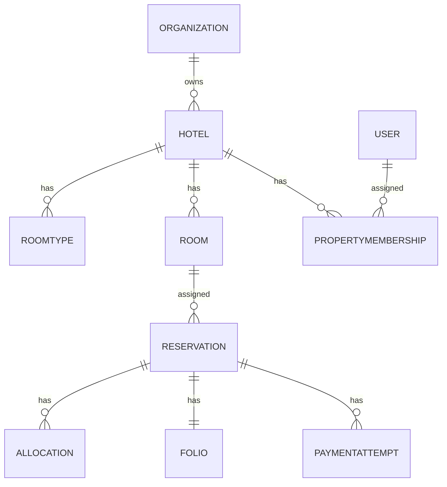

# Database architecture

Current: Django/DRF and Celery connect to PostgreSQL via `DATABASE_URL` (direct or session pooler); Vue talks to Django. The development provider simulates payments. Supabase services and Data API usage have not been verified. Hotel supplies timezone and currency; room and room type point to hotel, reservations to room and guest, folio to reservation, and payment to attempt/reservation. Allocation's active GiST exclusion arbitrates overlapping room ranges, including maintenance.

Organization and membership are proposed by the unapplied migration; membership is not authorization. Target: every operational record has validated hotel ownership; explicit roles and permissions are checked in API and services; financial and audit history are durable, and a scoped non-owner database role supplies defense in depth.

Index strategy: current FK indexes support joins; unique `(hotel, number)` supports room lookup, reference and event unique indexes support lookup/idempotency, and GiST exclusion supports active conflicts. Prepared membership unique indexes support user/property and user/organization membership lookups, with FK indexes for reverse lookups. Future indexes should follow measured query plans: `(hotel,status,arrival)` for arrivals, property/date for reports, guest email for access lookup, partial pending outbox by retry time, audit `(property,timestamp)` and resource lookup. Use `EXPLAIN (ANALYZE, BUFFERS)` in staging and concurrent index creation for large tables, after estimating write/storage costs; none of these proposed indexes is implemented yet.
